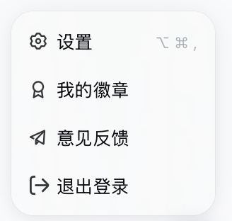
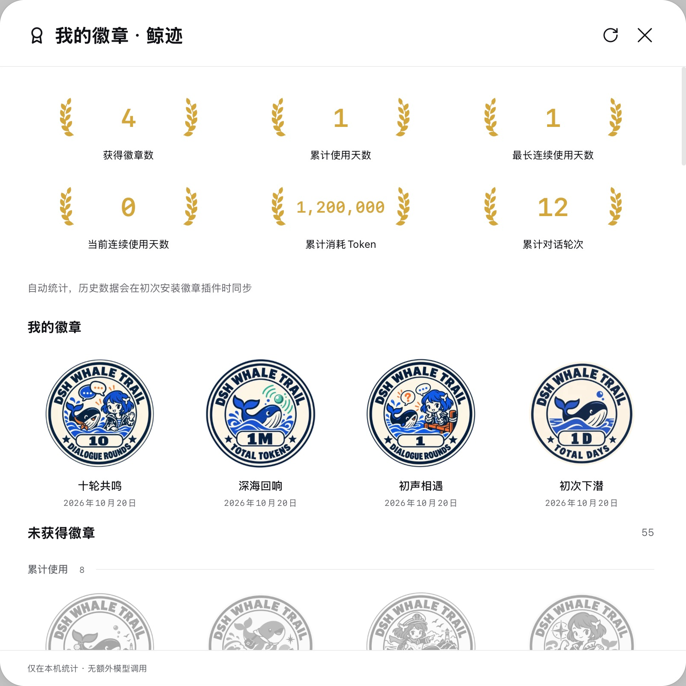
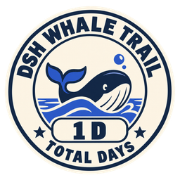
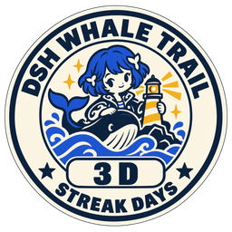
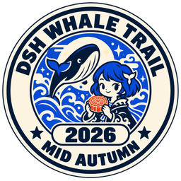
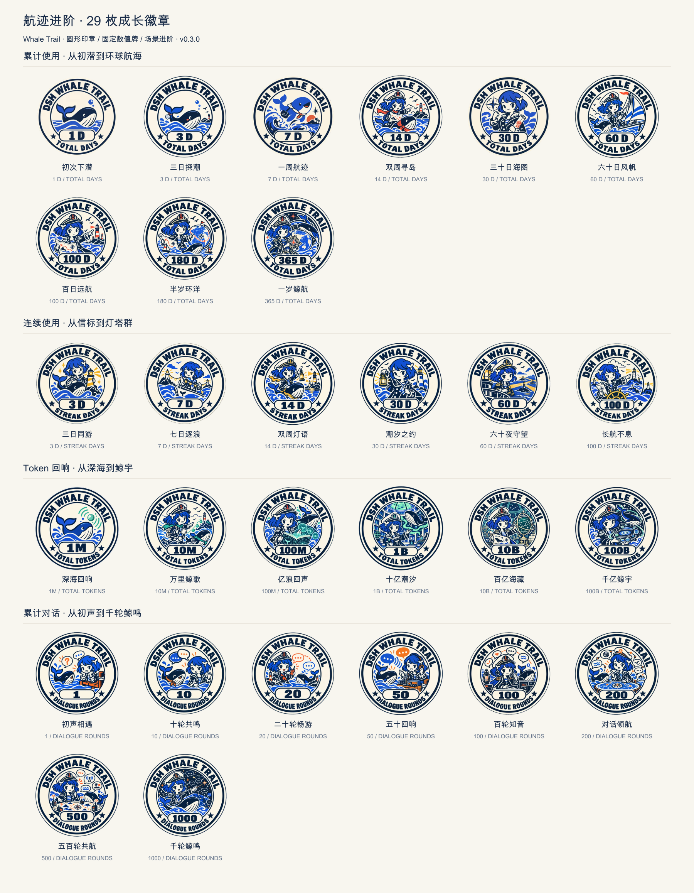
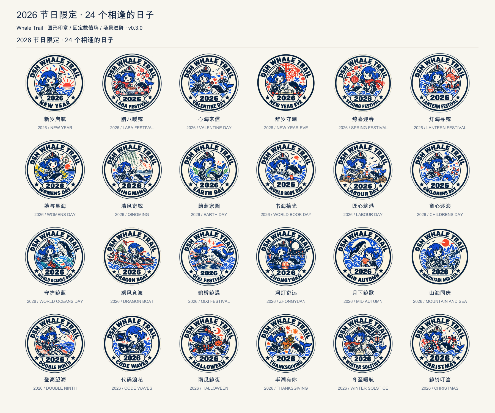

# Whale Trail · 鲸迹

**让每一次探索，都留下一枚值得收藏的徽章。**

Whale Trail for DeepSeek Harness 是一款以小鲸鱼为主题的成就徽章插件。它把日常的使用天数、连续使用、Token 用量与对话轮次，变成一册会逐渐点亮的航海收藏。达到条件就自动获得，不需要打卡、领取或确认完成，让成长记录自然发生在工作之中。

*Whale Trail is a local-first achievement badge collection for DeepSeek Harness. Earn whale-themed badges automatically as you explore, build, and talk with your agent.*

> **非官方社区项目，由社区成员独立开发与维护，未获 DeepSeek 官方背书。** 当前版本 **0.3.0**，已验证 **macOS / DeepSeek Harness 0.2.1-rc.2**。

[下载与安装](#安装) · [徽章示例](#徽章示例) · [备份与迁移](#备份与迁移) · [反馈与建议](https://github.com/ShawnRen57/dsh-whale-trail/issues)

## 你的使用足迹，值得被看见

- **自动点亮**：正常使用 Harness，满足条件即获得；首次安装时同步可读取的历史记录。
- **有进阶的收藏**：圆形印章与贴纸风格，统一数值牌；小鲸鱼的装备、角色与航海场景随等级变化。
- **一眼看见成长**：六项成就统计，包括徽章数、累计天数、最长连续、当前连续、Token 与对话轮次。
- **有惊喜的探索**：节日限定与隐藏徽章；未获得的隐藏徽章只展示名称和问号占位，保留发现的乐趣。
- **本地记录**：不新增模型调用，不上传聊天内容；支持导出备份，在自己的设备间迁移。

点击 Harness 左下角 **用户信息 → 我的徽章**，打开你的收藏册。



*账户菜单入口：点击带奖章图标的「我的徽章」。点击图片可查看高清原图。*



*Retina 原始截图，点击图片可查看高清原图。图中为独立测试档案的演示进度。已获得徽章按获得时间倒排；未获得徽章分类展示，普通徽章为灰色，悬浮可查看获得方式。*

## 徽章示例

目前包含 **59 枚徽章、6 个系列**：累计使用、连续使用、Token 回响、累计对话、节日限定与隐藏典藏。

<table>
  <tr>
    <td align="center"><br><b>初次下潜</b><br>累计使用 · 1 天</td>
    <td align="center"><br><b>三日同游</b><br>连续使用 · 3 天</td>
    <td align="center"><br><b>深海回响</b><br>Token 回响 · 1M</td>
  </tr>
  <tr>
    <td align="center"><br><b>初声相遇</b><br>累计对话 · 1 轮</td>
    <td align="center"><br><b>月下鲸歌</b><br>节日限定 · 中秋</td>
    <td align="center"><br><b>还有未被发现的航迹</b><br>隐藏典藏 · 等你探索</td>
  </tr>
</table>

| 系列 | 当前内容 |
| --- | --- |
| 累计使用 | 1 / 3 / 7 / 14 / 30 / 60 / 100 / 180 / 365 天 |
| 连续使用 | 3 / 7 / 14 / 30 / 60 / 100 天 |
| Token 回响 | 1M / 10M / 100M / 1B / 10B / 100B |
| 累计对话 | 1 / 10 / 20 / 50 / 100 / 200 / 500 / 1000 轮 |
| 节日限定 | 2026 年 24 枚：中国传统节日与国际节日，详见下方 |
| 隐藏典藏 | 6 枚设计，4 枚可自动识别；另外 2 枚等待宿主行为证据适配后启用 |





节日包括元旦、腊八、情人节、除夕、春节、元宵、国际妇女节、清明、世界地球日、世界读书日、劳动节、儿童节（中国）、世界海洋日、端午、七夕、中元、中秋、国庆、重阳、程序员节、万圣节前夜、感恩节（美国）、冬至、圣诞节。以各文化节日当天为准，当前仅内置 **2026 年**；日期与地区定义见 [年度日历来源](docs/calendar-sources.md)。

旧版 10K / 100K Token 徽章移除，仅展示新体系，不计入获得徽章数。真实使用记录保留，旧备份仍可导入。升级根据真实使用记录重算新增等级，已达标即可自动点亮。隐藏典藏的设计与获得条件保持不变。

**徽章会持续更新。** 后续将继续带来新的主题、进阶设计、节日限定与隐藏惊喜，并随 Harness 的能力演进完善识别规则。欢迎在 [Issues](https://github.com/ShawnRen57/dsh-whale-trail/issues) 提交喜欢的主题或新的成就点子，关注 [Releases](https://github.com/ShawnRen57/dsh-whale-trail/releases) 获取更新。

## 安装

当前发布预构建安装包，无需自行编译，也不需要配置额外模型或 API Key。

1. 确认使用 **DeepSeek Harness 0.2.1-rc.2**。其他宿主版本尚未验证。
2. 从 [v0.3.0 Release](https://github.com/ShawnRen57/dsh-whale-trail/releases/tag/v0.3.0) 下载 `dsh-whale-trail-0.3.0.tgz`。
3. 在终端执行以下命令，将文件路径替换为实际下载位置：

```sh
dsh plugin --profile desktop add 'file:/绝对路径/dsh-whale-trail-0.3.0.tgz' --ignore-scripts
```

macOS 上如果没有安装全局 `dsh` 命令，可以调用应用自带的 CLI：

```sh
'/Applications/DeepSeek Harness.app/Contents/Resources/runtime/cli/bin/dsh' plugin --profile desktop add 'file:/绝对路径/dsh-whale-trail-0.3.0.tgz' --ignore-scripts
```

4. 重新启动 Harness，打开左下角 **用户信息 → 我的徽章**。

升级时安装新的 `.tgz` 并重启，原有本地进度会保留。若需禁用，可在 Harness 插件页操作；卸载插件可使用 `dsh plugin --profile desktop remove dsh-whale-trail --ignore-scripts`，本地徽章账本仍保留。

## 怎么统计

**自动统计，历史数据会在初次安装徽章插件时同步。** 只统计能够核实的历史，重复扫描或重复导入不会叠加进度。

- **使用天数**：按固定时区中的自然日累计，一天多次使用只计一天。默认时区为 `Asia/Shanghai`。
- **连续使用**：同时记录最长连续和当前连续，当前连续允许从昨天接续到今天。
- **Token**：累计 Harness 正式记录的模型用量，不估算缺失记录。
- **对话轮次**：一次用户输入得到可见的 Agent 回复，并正常结束，计 1 轮；一条聊天可以累计多轮。多条排队输入合并为同一回合时只计 1 轮，工具调用、重试、失败、中止和后台自动续跑不单独计轮。
- **节日限定**：按文化日期判断，不按调休假期；当前内置 2026 年日历。

归档会话、手动确认和主动领取均不参与计数。更详细的事件规则和兼容边界见 [开发与实现说明](docs/DEVELOPMENT.md)。

## 备份与迁移

在“我的徽章”弹窗底部点击 **导出备份**，换设备时带走生成的 **`.dshbadge` 文件**。新设备安装插件后，使用相同档案和时区，选择 **导入备份**；先预览新增与重复记录，再确认合并。

默认数据保存在：

```text
~/.dsh-whale-trail/profiles/personal/whale-trail.sqlite
```

插件只保存成就所需的最小事件特征，不保存提示词、回复正文、附件、API 密钥或登录凭据。备份为明文元数据文件；当前提供手动迁移，不提供自动云同步。日常迁移请使用 `.dshbadge`，不要直接同步运行中的 SQLite 文件。

## 开发与反馈

插件包含 Host 统计服务、账户菜单入口与徽章弹窗。原始 PNG、256px PNG 和 WebP 分别保存在 `assets/badges/`、`assets/png-256/` 与 `assets/web/`。

构建、测试、配置和已知边界见 [开发说明](docs/DEVELOPMENT.md)。发现问题或想投稿徽章主题，请提交 [Issue](https://github.com/ShawnRen57/dsh-whale-trail/issues)，附上 Harness 版本、插件版本与复现方式。

源代码与原创 AI 辅助生成物料一并公开；当前包的许可声明为 `UNLICENSED`，尚未授予开源许可证。
